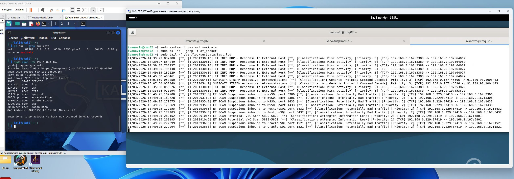
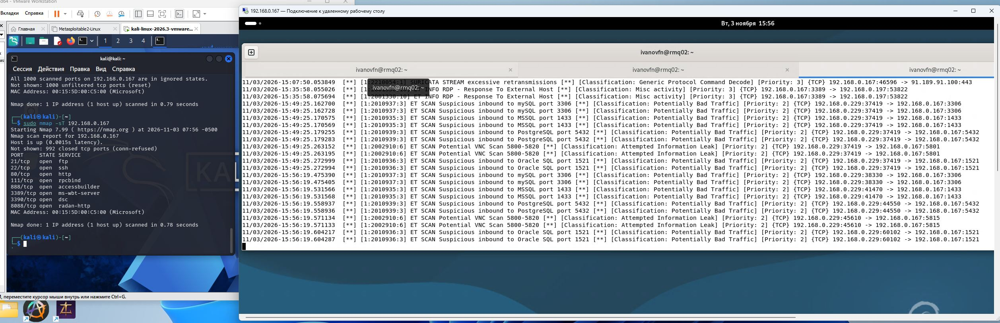
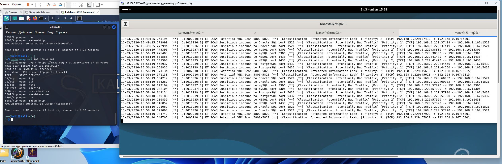
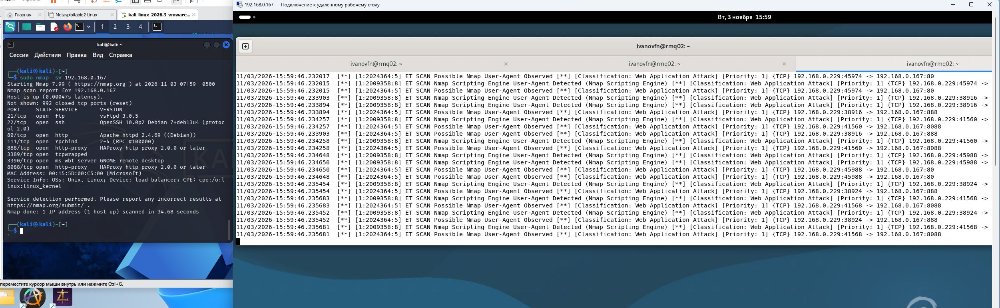
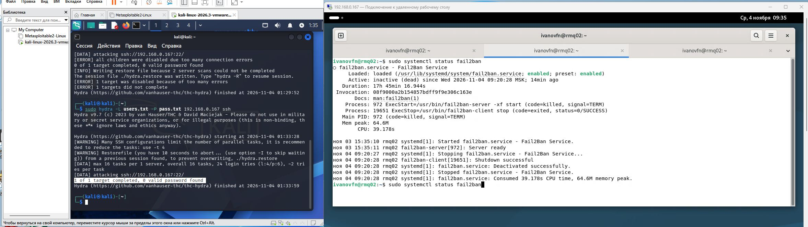
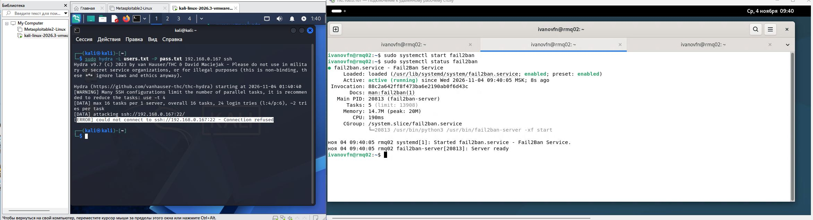

# Домашнее задание к занятию «Защита сети» - `Иванов Федор`

Задание 1
Проведите разведку системы и определите, какие сетевые службы запущены на защищаемой системе:

sudo nmap -sA < ip-адрес >

sudo nmap -sT < ip-адрес >

sudo nmap -sS < ip-адрес >

sudo nmap -sV < ip-адрес >

По желанию можете поэкспериментировать с опциями: https://nmap.org/man/ru/man-briefoptions.html.
В качестве ответа пришлите события, которые попали в логи Suricata и Fail2Ban, прокомментируйте результат.

1. Провел разведку с помощью nmap. Полученные результаты видим на скриншоте 1-4. При первом сканировании  из логов Suricata видим, что система заметила подозрительный HTTP‑запрос к порту 8088 на машине 192.168.0.167 от 192.168.0.229.
2. При втором сканировании видим работу Nmap, а точнее на его компонент Nmap Scripting Engine (NSE).Система мониторинга зафиксировала: (а) подозрительный доступ к базе данных, (б) протокольную аномалию, (в) точную идентификацию инструмента сканера. Причём самое высокоприоритетное событие (Priority 1) — не атака как таковая, а распознавание самой утилиты Nmap NSE. скриншот2
3. Третье сканирование скрншот3. Suricata уверенно детектирует сканирование диапазонов портов. Даже «тихий» SYN-скан по характерным диапазонам (вроде 5800–5820) фиксируется как подозрительная активность.
4. Четвертое сканаирование -sV оставляет сразу два типа следов в Suricata: аномалии протокола (как «missing colon») и сигнатуры инструментов (User‑Agent). Это значит, что даже «безобидное» определение версий легко детектируется IDS. скриншот 4

---

### Задание 2
Задание 2
Проведите атаку на подбор пароля для службы SSH:

hydra -L users.txt -P pass.txt < ip-адрес > ssh

Настройка hydra:
создайте два файла: users.txt и pass.txt;
в каждой строчке первого файла должны быть имена пользователей, второго — пароли. В нашем случае это могут быть случайные строки, но ради эксперимента можете добавить имя и пароль существующего пользователя.
Дополнительная информация по hydra: https://kali.tools/?p=1847.

Включение защиты SSH для Fail2Ban:
открыть файл /etc/fail2ban/jail.conf,
найти секцию ssh,
установить enabled в true.
Дополнительная информация по Fail2Ban:https://putty.org.ru/articles/fail2ban-ssh.html.
В качестве ответа пришлите события, которые попали в логи Suricata и Fail2Ban, прокомментируйте результат.

На скриншоте 5 видим работы hydra с выключенным Fail2Ban. В результате работы происходит подбор пароля но совпадений не обнаружено.
На скриншоте 6 уже с включенным Fail2Ban. Видим что подбор паролей не удался.

